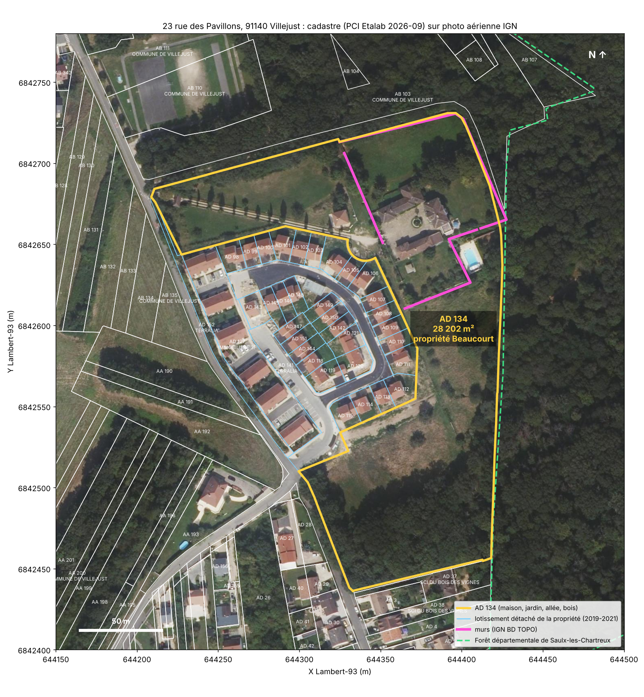
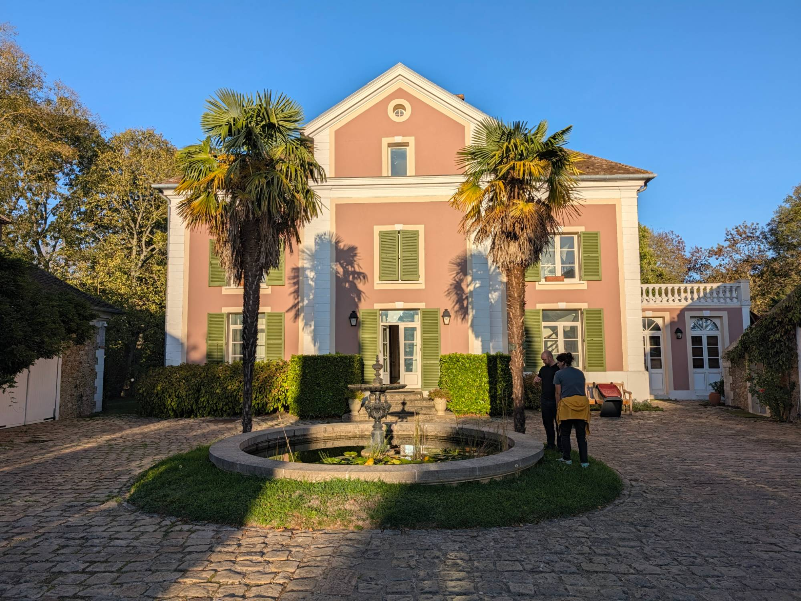
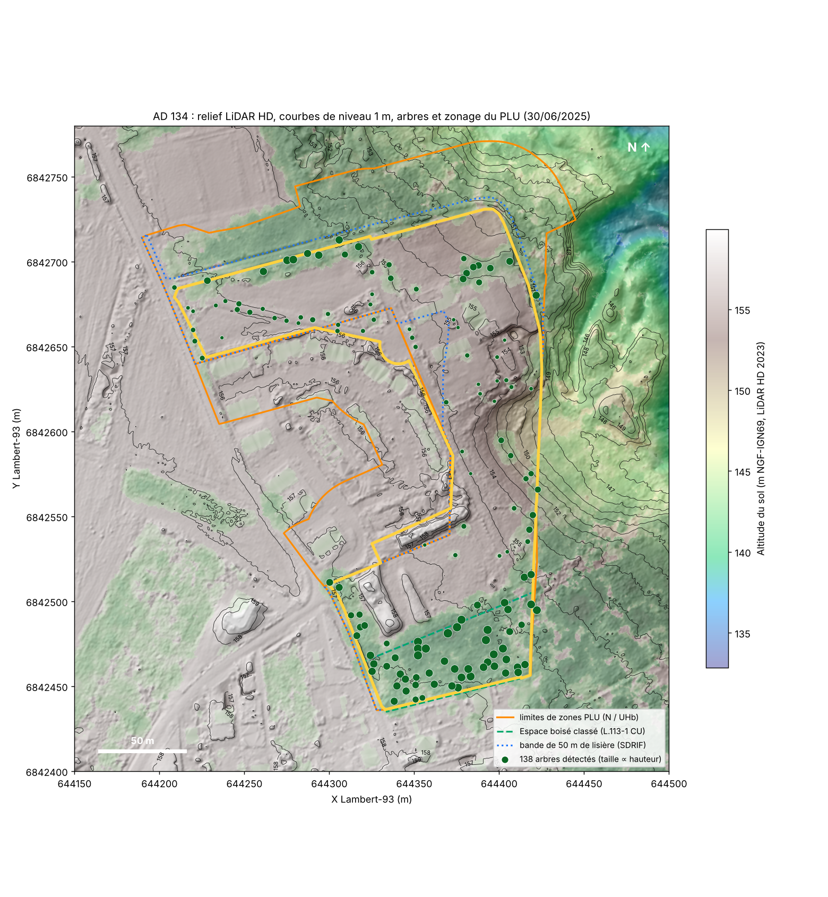

# Beaucourtmania : étude foncière du 23 rue des Pavillons, 91140 Villejust

**Projets de Jason Beaucourt. Villejust (INSEE 91666), Essonne, lieu-dit « Le Rocher ».**

Ce dépôt rassemble les données publiques sur la propriété familiale, la parcelle cadastrale **AD 134** (28 202 m²) :
la maison, le jardin, l'allée d'accès, le bois, le mur qui la sépare de la forêt départementale, et le
lotissement d'une cinquantaine de logements construit sur des terrains détachés de la propriété. Chaque chiffre
vient d'un fichier de `data/` produit par un script de `scripts/`. Rien n'est saisi à la main.



> Données récupérées le 14/10/2026. Coordonnées en Lambert-93 (EPSG:2154) et en WGS84. Altitudes en NGF-IGN69.
> Photos de terrain et ce qu'elles apprennent : [`photos/`](photos/README.md).

---

## Constats de terrain (photos du 14/10/2026)



- Une **maison de maître néoclassique du XIXᵉ siècle** (R+1+combles, fronton à oculus, enduit rose, tuiles plates),
  ouverte à l'ouest sur une **cour pavée** avec un bassin et sa fontaine en fonte.
- Au nord de la cour, des **communs en meulière** avec portes charretières, couverts de glycine. À l'ouest, le
  **portail** sur piliers et la **maison de gardien**.
- L'allée d'accès est bordée de **cyprès d'Italie**. Devant la maison poussent deux **palmiers de Chine**.
- La meulière apparente des communs confirme la géologie locale (argile à meulière) et donne le matériau probable
  du mur de clôture côté forêt.

Détail, inventaire des plantes et photos encore à prendre : [`photos/README.md`](photos/README.md).

## 1. La parcelle et le lotissement

| | Valeur | Source |
|---|---:|---|
| Parcelle | **AD 134** | cadastre PCI Etalab 2026-09 |
| Contenance cadastrale | **28 202 m²** (2,82 ha) | |
| Périmètre | 1 010 m, 93 sommets | [`sommets_AD134_lambert93.csv`](data/cadastre/sommets_AD134_lambert93.csv) |
| Créée au cadastre (dans sa forme actuelle) | 22/06/2020 | |
| Bâti « dur » au cadastre | 5 bâtiments, 723 m² d'emprise | [`batiments.csv`](data/cadastre/batiments.csv) |

AD 134 a la forme d'un grand **U** autour du lotissement : l'allée bordée d'arbres part de la rue des Pavillons au
nord-ouest, la maison et la piscine sont au nord-est, le bois occupe toute la partie sud. **La limite est de AD 134 est
aussi la limite entre Villejust et Saulx-les-Chartreux** : au-delà commence la Forêt départementale de Saulx-les-Chartreux.

**Le lotissement** compte 36 parcelles (14 429 m², 49 bâtiments, 3 683 m² d'emprise). Ses lots ont été créés au cadastre
le 10/01/2019 (AD 98 à 115) puis le 17/03/2021 (AD 141 à 152). Les ventes (DVF) racontent l'opération :

- **2021 à 2024 : 22 ventes en l'état futur d'achèvement (VEFA)**, de 310 000 € à 434 000 € par logement ;
- **24/01/2024 : 12 lots vendus d'un bloc pour 4 053 476 €** à **Essonne Habitat** (bailleur social) ;
- AD 141 et AD 152 (les collectifs) appartiennent à **Terralia** (coopérative HLM), AD 127 à **Immobilière 3F**.

Détail : [`dvf_propriete_et_lotissement.csv`](data/marche/dvf_propriete_et_lotissement.csv). Prix médian d'une maison
à Villejust : environ 3 800 €/m² de 2021 à 2025 ([`dvf_commune_maisons_prix_m2.csv`](data/marche/dvf_commune_maisons_prix_m2.csv)).
**AD 134 elle-même n'a pas été vendue entre 2021 et 2025.**

## 2. Qui possède quoi

Le fichier DGFiP des **personnes morales** (millésime 2025) ne publie jamais les propriétaires personnes physiques.
[`proprietaires_personnes_morales.csv`](data/cadastre/proprietaires_personnes_morales.csv) liste les sociétés et les
collectivités autour de la propriété.

| Propriétaire | Parcelles | Ce que c'est |
|---|---|---|
| **Département de l'Essonne** | **G 17 (28 508 m²), G 53, G 44 à Saulx-les-Chartreux** : 180 m de limite commune avec AD 134 ; 123 parcelles en tout dans le secteur | **la forêt départementale, à l'est** |
| **Commune de Villejust** | **AB 103** (13 150 m², bois, prés), au nord du mur ; 18 parcelles en tout, dont les terrains de sport | **le bois au nord** |
| Essonne Habitat | 12 lots du lotissement | logements sociaux |
| Terralia, Immobilière 3F | AD 141, AD 152, AD 127 | collectifs du lotissement |
| SCI du Bois des Vignes (radiée) | AD 37, AD 39 (voisines au sud) | siège 25 rue des Pavillons |
| **ENEDIS** | **AD 134** inscrite au rôle « gérant, mandataire, gestionnaire / propriétaire » | voir ci-dessous |

> ⚠️ **AD 134 apparaît dans le fichier des personnes morales au nom d'ENEDIS.** Le plus probable est que cela tienne au
> **poste électrique** : le PLU place une servitude **I4** (ligne ou ouvrage électrique) de 44 m² sur la parcelle, et le
> cadastre y montre un petit bâtiment de 26 m² dans le bois sud. Cela ne prouve pas qu'ENEDIS soit propriétaire du
> terrain. Seul un **relevé de propriété** (mairie ou centre des impôts fonciers) ou une **demande de renseignements
> au service de la publicité foncière** (formulaire 3233-SD, ouvert à tous) donne le titulaire exact des droits.

## 3. Urbanisme : PLU de Villejust du 30/06/2025

| Zone ou prescription | Surface dans AD 134 | Part |
|---|---:|---:|
| **Zone N, naturelle** | **26 761 m²** | **94,9 %** |
| Zone UHb, lotissements pavillonnaires | 1 424 m² | 5,1 % |
| **Bande de 50 m de protection des lisières** (massif boisé > 100 ha, SDRIF) | 22 028 m² | 78,2 % |
| **Espace boisé classé** (art. L.113-1 du Code de l'urbanisme) | 3 723 m² | 13,2 % |
| Servitude I4 (électricité) | 44 m² | 0,2 % |
| Droit de préemption urbain | 1 424 m² | 5,1 % |
| Taxe d'aménagement | 20 % | |

Règlement complet : [`91666_reglement_20250630.pdf`](data/urbanisme/91666_reglement_20250630.pdf) (zone N p. 107-113 ;
EBC et lisières p. 17). Ce que cela veut dire pour la maison, en zone N :

- **extension** des habitations existantes : **+30 m² d'emprise au sol au maximum**, une fois, au total ;
- **annexes** (abri, garage…) : 20 m² d'emprise au maximum, à moins de 20 m de la maison ;
- **aucune surélévation** : la hauteur existante est conservée ;
- toute construction nouvelle à **8 m au moins** de la voie et de toutes les limites séparatives ;
- dans la **bande de lisière** : toute construction nouvelle est interdite (sauf agricole et énergies renouvelables) ;
- dans l'**EBC** : défrichement refusé de plein droit, coupes et abattages soumis à **déclaration préalable**,
  sol imperméable et remblais interdits.

Les articles de loi et les démarches (permis, déclaration préalable, mur mitoyen, distances de plantation) sont dans
[`REGLEMENTATION.md`](REGLEMENTATION.md).

## 4. Topographie : LiDAR HD IGN

Vol d'**avril-mai 2023**, nuage de points classé à **29 points/m²** (3,9 millions de points sur la zone d'étude).

| Zone | Surface | Altitude min-max | Dénivelé | Pente médiane | Pente du 10 % le plus raide |
|---|---:|---|---:|---:|---:|
| **AD 134 entière** | 28 186 m² | 148,4 à 159,7 m | **11,3 m** | 3,5° | 12° |
| Bâti | 723 m² | 154,2 à 156,2 m | 2,0 m | 3,5° | 7,8° |
| Bois (canopée > 5 m) | 9 714 m² | 148,6 à 158,3 m | 9,8 m | 3,9° | 11,2° |
| Pelouse, sol nu, allée | 15 936 m² | 148,4 à 159,7 m | 11,3 m | 3,1° | 12,3° |

Le plateau (155-158 m) porte la maison, le jardin et le lotissement. **Le terrain tombe vers l'est** : la limite avec
la forêt suit un **talus de 6 à 7 m** (de 155 à 148 m) qui se poursuit dans la forêt départementale. Dans la partie sud,
le relief montre **deux buttes allongées** d'environ 1,5 m : probablement des terres de chantier du lotissement, à vérifier
sur les photos.



Fichiers : [`topographie_AD134.csv`](data/lidar/topographie_AD134.csv), rasters MNT/MNS/MNH à 50 cm dans
[`data/lidar/`](data/lidar/), nuage de points découpé [`villejust_nuage_points.laz`](data/lidar/villejust_nuage_points.laz)
(s'ouvre dans CloudCompare ou QGIS).

## 5. Arbres et végétation

| Occupation du sol (LiDAR) | Surface | Part | Hauteur médiane |
|---|---:|---:|---:|
| **Canopée arborée (> 5 m)** | **9 714 m²** | 34,5 % | **16,7 m** |
| Arbustes, haies (2-5 m) | 1 812 m² | 6,4 % | 3,5 m |
| Pelouse, sol nu, allée (< 2 m) | 15 936 m² | 56,5 % | |
| Bâti | 723 m² | 2,6 % | |

- **130 arbres** repérés dans AD 134 par le LiDAR (sommets de couronne), dont **57 de plus de 20 m** ; le plus haut
  mesure **29,5 m**. Position, hauteur et rayon de couronne : [`arbres_lidar_AD134.csv`](data/vegetation/arbres_lidar_AD134.csv).
  Le comptage est fiable pour les grands arbres isolés et sous-estime les arbres serrés du bois.
- **Essences** (BD Forêt V2 de l'IGN) : le bois est une **forêt fermée de châtaignier pur** sur 5 246 m² et une **forêt
  fermée de feuillus en mélange** sur 2 028 m². L'allée est bordée d'un **alignement d'arbres** (BD TOPO « haie »).
- Photos infrarouges (santé de la végétation) 2018, 2021 et actuelle : [`data/histoire/`](data/histoire/).

## 6. Le mur

La BD TOPO de l'IGN recense **trois murs** autour de la maison (précision ± 2,5 m) :

| Mur | Longueur | Sur la limite de AD 134 | Dénivelé le long du mur | De l'autre côté |
|---|---:|---:|---:|---|
| **Mur nord et est** (enclos de la maison) | **163,7 m** | **132,5 m** | 3,9 m | au nord **AB 103, Commune de Villejust** ; à l'est **G 17 / G 53 / G 44, Département de l'Essonne** |
| Mur sud du jardin (autour de la piscine) | 91,5 m | dans la parcelle | 3,4 m | AD 134 |
| Mur ouest de la maison | 60,2 m | dans la parcelle | 0,9 m | AD 134 |

Profil du sol tous les mètres le long de chaque mur : [`murs_profil_1m.csv`](data/lidar/murs_profil_1m.csv). La nature
(pierre meulière, moellons…), la hauteur, l'épaisseur et l'état viendront des photos. **La propriété du mur** (privatif
ou mitoyen avec le Département) se juge sur titre et sur les marques de mitoyenneté (Code civil, art. 653 et 654).

## 7. Sols et risques

| Risque | Niveau | Source |
|---|---|---|
| **Retrait-gonflement des argiles** | **exposition forte** | Géorisques |
| Inondation, coulées de boue | **8 arrêtés CatNat** (1988 à 2021) | [`arretes_catnat.csv`](data/risques/arretes_catnat.csv) |
| Sécheresse | **3 arrêtés CatNat** (1995-96, 2003, 2006) | |
| Mouvement de terrain | 1 arrêté (tempête de décembre 1999) | |
| Séisme | zone 1, très faible | |
| Radon | catégorie 1, faible | |
| Cavités souterraines | aucune à moins de 1 km | |

- L'exposition forte aux argiles impose une **étude géotechnique G1** avant la vente d'un terrain constructible
  (Code de la construction, art. L.132-4 et suivants). Elle explique aussi les fissures à surveiller sur la maison et le
  mur. Les sécheresses de 1995-96, 2003 et 2006 ont été reconnues CatNat.
- Carte des sols INRAE au 1/1 000 000 : [`carte_sols_inrae.png`](data/sols/carte_sols_inrae.png). Le plateau du
  Hurepoix porte en général des limons sur argile à meulière, au-dessus des sables de Fontainebleau qui affleurent
  dans les pentes ; **à confirmer sur la carte géologique BRGM au 1/50 000**, bloquée depuis l'environnement cloud
  (à consulter sur [infoterre.brgm.fr](https://infoterre.brgm.fr)). Les photos du talus est et du mur aideront.

## 8. Histoire : photos aériennes

[`data/histoire/`](data/histoire/) contient la même emprise vue en **1950-1965, 1965-1980, 1980-1995, 2000-2005**, en
infrarouge 2018 et 2021, et aujourd'hui. Elles montrent l'état de la propriété avant le lotissement.

---

## Refaire l'étude

```bash
pip install rasterio laspy[lazrs] shapely pyproj matplotlib scipy pyarrow numpy
bash scripts/fetch.sh                       # toutes les sources publiques dans data/raw/
export PYTHONPATH=scripts
python3 scripts/parcels.py                  # cadastre, lotissement, sommets
python3 scripts/lidar.py data/raw/LHD_FXX_0644_6843.copc.laz   # relief, arbres, murs, nuage de points
python3 scripts/urbanisme.py                # zonage PLU et risques
python3 scripts/dvf.py                      # ventes
python3 scripts/proprietaires.py data/raw/unite-fonciere-2025-91-agg.parquet
python3 scripts/carte.py                    # cartes/
```

## Limites connues

- Le cadastre sert à l'impôt et ne fait pas foi pour les limites ; seul un **bornage par géomètre-expert** les fixe.
- Les deux petits bâtiments sous les arbres (26 m² et 42 m²) ont une hauteur LiDAR faussée par la canopée
  (`hauteurs_batiments_AD134.csv`) ; il faut les recalculer avec les seuls points classés « bâtiment ».
- Les propriétaires personnes physiques ne sont pas publiés.
