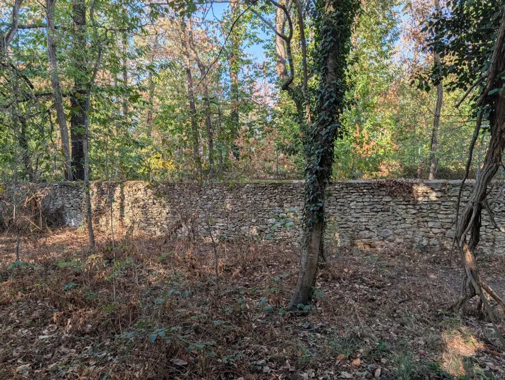

# Projet : renforcer le mur en pierre (≈ 140 m)

Projet de long terme. Objectif : un mur **fonctionnel** (tenir, arrêter les sangliers), au **moindre coût et au
moindre effort**, pas un mur de prestige.

## Ce qu'on sait déjà

- C'est le mur « nord et est » de la BD TOPO de l'IGN : **164 m** au total, dont **132,5 m sur la limite de AD 134**
  (précision ± 2,5 m) ; voir [`murs_AD134.csv`](../data/lidar/murs_AD134.csv) et la carte
  [`plan_propriete.png`](../cartes/plan_propriete.png) (trait rose).
- De l'autre côté : au **nord** le bois de la **Commune de Villejust** (AB 103), à l'**est** la forêt du
  **Département de l'Essonne** (G 17, G 53, G 44 à Saulx-les-Chartreux).
- Moellons de calcaire et de meulière, joints à la chaux en grande partie vidés, **chaperon plat** maçonné, hauteur
  visible d'environ 1,3 à 1,6 m côté propriété.
- **Une partie du mur retient de la terre.** D'après le LiDAR, entre 90 et 130 m environ le long du tracé (descente
  vers l'angle nord-est puis le flanc est), le sol est **plus bas de 1,5 à 2 m d'un côté que de l'autre** : c'est un
  **mur de soutènement**, plus exposé à la poussée et à l'eau. Ailleurs le sol est au même niveau des deux côtés.
- Une **lézarde ouverte** a déjà été photographiée, avec un jeune arbre au pied ; sols à **exposition forte aux argiles**.

## Étape 0 : qui paie ? (gratuit, et peut diviser le coût par deux)

1. **Mitoyenneté** : un mur séparatif est présumé mitoyen (Code civil, art. 653). S'il l'est, **la Commune (nord) et
   le Département (est) paient la moitié** des réparations (art. 655). Lire le titre de propriété, puis les marques
   sur le mur (art. 654 : chaperon à deux pentes = mitoyen ; une seule pente = appartient au côté vers lequel elle
   penche).
2. Écrire au **service des Espaces naturels sensibles du Département** : il gère la forêt et a intérêt à un mur
   qui tient (sécurité des promeneurs, sangliers).
3. Ne jamais réparer au ciment avant d'avoir réglé ce point : un voisin public peut contester des travaux faits seul.

## Étape 1 : diagnostic en une journée

Parcourir le mur avec un téléphone (GPS activé) et classer chaque tronçon de 5 m :

| État | Signe | Traitement |
|---|---|---|
| **A, sain** | droit, joints en place | entretien seulement |
| **B, joints vides** | pierres qui bougent à la main, mortier sableux | rejointoiement |
| **C, désordre** | lézarde, ventre, faux aplomb | reprise locale |
| **D, effondré** | brèche, pierres au sol | barrière de remplacement |

Je peux fournir une fiche tronçon par tronçon, préremplie avec l'altitude du sol tous les mètres
([`murs_profil_1m.csv`](../data/lidar/murs_profil_1m.csv)), et placer les photos sur le plan.

## Étape 2 : les gestes qui rapportent le plus pour presque rien

1. **Dégager une bande de 1 à 2 m** au pied du mur : couper les jeunes arbres (leurs racines écartent les pierres) et
   le lierre à la base, sans arracher celui qui tient dans les joints (il partirait avec le mortier).
2. **Refaire le chaperon** là où il est ouvert : c'est par le haut que l'eau entre et que le gel fait éclater le mur.
   Un bourrelet de **mortier de chaux** en dos d'âne suffit.
3. Sur la partie en **soutènement**, ouvrir des **barbacanes** (trous d'évacuation) en pied de mur tous les 2 à 3 m
   et curer le côté haut : l'eau qui s'accumule derrière est la première cause d'effondrement.

## Étape 3 : réparer selon l'état, toujours au plus simple

- **B, joints vides** : **rejointoyer à la chaux hydraulique naturelle** (NHL 3,5) et sable, en commençant par les
  zones les plus dégradées. Faisable soi-même, l'essentiel du coût est le temps.
- **C, lézarde ou ventre** : démonter et remonter **seulement le tronçon** concerné avec les mêmes pierres. Sur le
  soutènement, préférer des **contreforts** (un tous les 5 à 8 m) plutôt que tout reconstruire.
- **D, brèche** : ne pas remonter en maçonnerie. Remplir la brèche par un **gabion** (cage en grillage acier remplie
  avec **les pierres tombées du mur lui-même**) : sans mortier, drainant, il encaisse les mouvements des argiles et se
  pose soi-même.
- **Jamais de ciment** sur ce mur : trop rigide, il bloque l'humidité et fait éclater la pierre.

## Étape 4 : arrêter les sangliers sans hausser le mur

Un mur de 1,5 m en bon état arrête déjà la plupart des sangliers ; ils passent par les brèches et par-dessous.
Solution la moins chère : un **grillage à mailles serrées (type « ursus »)** de 1,2 m côté propriété, **replié au sol
sur 30 à 40 cm** vers l'extérieur (bavolet anti-fouissement) ou enterré, et éventuellement **un fil électrique à 20 cm
du sol**. Il couvre aussi les brèches en attendant leur réparation.

À vérifier : en zone N, la loi du 2 février 2023 sur l'engrillagement (Code de l'environnement, art. L.372-1) encadre
les nouvelles clôtures au-delà de **150 m de l'habitation** ; le mur nord et est en est proche, donc a priori exempté.

## Démarches

- **Entretien et réparation à l'identique** d'un mur existant : pas d'autorisation en général. Une
  **reconstruction** ou une modification visible peut demander une **déclaration préalable** si la commune soumet
  les clôtures à déclaration (Code de l'urbanisme, art. R.421-12) : demander à la mairie.
- Bande de lisière et EBC : réparer un mur existant est permis ; ne pas élargir la bande défrichée au-delà du
  nécessaire, ne rien bétonner au sol.

## Ordre des coûts (à confirmer par devis)

L'essentiel du coût est la **main-d'œuvre** : tout ce qui peut se faire soi-même (étapes 2, 3-B, gabions, grillage)
divise la facture. Les ordres de grandeur ci-dessous sont indicatifs et varient beaucoup selon l'état réel.

| Poste | Fait soi-même | Par une entreprise |
|---|---|---|
| Grillage ursus sur 140 m, piquets, bavolet | quelques centaines à ~1 500 € de fournitures | quelques milliers d'euros |
| Chaperon à la chaux | sacs de chaux et sable, quelques centaines d'euros | de l'ordre de 50 à 100 € le mètre |
| Rejointoiement chaux | fournitures modestes, beaucoup de temps | de l'ordre de 60 à 120 € le m² par face |
| Gabion avec les pierres du mur | cages de quelques dizaines d'euros le m³ | |
| Remontage maçonné d'un tronçon | | plusieurs centaines d'euros le m² |

**Ordre conseillé :** étape 0 et diagnostic → dégagement du pied et chaperon → grillage anti-sangliers → brèches en
gabion → rejointoiement par tronçons, au fil des années.
